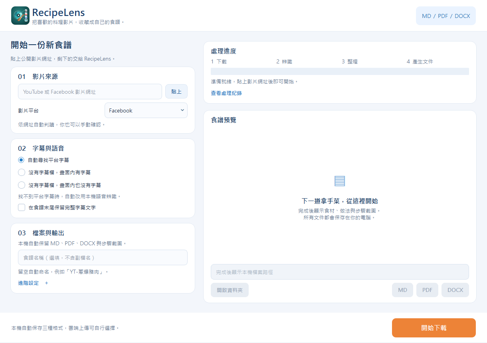

# RecipeLens

## Codex 專案 Skill

一般開發規則見根目錄 `AGENTS.md`。食譜產物驗證與轉換故障排查使用 `.agents/skills/recipelens-validate/SKILL.md`，可在 Codex 輸入 `$recipelens-validate`。例如：「使用 $recipelens-validate 檢查指定食譜的三種文件與截圖，不重新下載或上傳。」此技能只適用於食譜轉換驗證，不會因建立 Skill 就自動下載影片、呼叫 AI 或上傳雲端。

從 YouTube 或 Facebook 料理影片整理繁體中文食譜，輸出 Markdown 與關鍵步驟截圖。

## Windows 開發環境

1. 安裝 uv、FFmpeg，以及 ChatGPT 桌面版（Codex）或 Claude 桌面版（Claude Code），擇一即可；獨立的 Codex CLI／Claude Code CLI 也可。將包含 `ffmpeg.exe`、`ffprobe.exe` 的資料夾加入 Windows 使用者 PATH，並重新開啟 PowerShell。YouTube 擷取可能需要在 PATH 安裝 Deno。
2. 在專案目錄執行 `uv sync`，建立專案環境並安裝 yt-dlp。
3. 使用 Codex 時執行 `codex login` 登入，或用 `codex login status` 確認現有登入狀態。使用 Claude 時不需要 API 金鑰，也不需要開命令視窗：有 Pro 或 Max 月租即可。第一次用 Claude 轉換（或登入過期）時，RecipeLens 會在背景執行 `claude auth login`，自動開啟瀏覽器請你登入，登入後自動繼續；也可在「進階設定」按「登入 Claude 帳號」先登入。RecipeLens 呼叫 Claude 時會略過 `ANTHROPIC_API_KEY` 環境變數，確保使用月租額度而不是 API 計費；用量和 claude.ai 共用同一份額度。所有外部工具（FFmpeg、yt-dlp、Codex、Claude）都在背景執行，不會跳出黑色命令視窗。

## 執行

### Windows 安裝程式

安裝版使用 PyInstaller 資料夾版加上 Inno Setup，產出 `RecipeLens-Setup-<版本>.exe`。預設安裝到 `%LOCALAPPDATA%\Programs\RecipeLens`，不需要系統管理員權限；安裝時也可選擇為所有使用者安裝。安裝程式會建立開始功能表捷徑（桌面捷徑可選），並可從 Windows「設定 → 應用程式」解除安裝。

安裝版的資料位置：

| 內容 | 位置 |
|---|---|
| 程式、FFmpeg、yt-dlp、Deno | 安裝資料夾 `tools\` |
| 設定與 Google 授權 | `%LOCALAPPDATA%\RecipeLens\config\` |
| 食譜輸出（預設） | 「文件\RecipeLens\」，可在本機設定更改 |

升級或解除安裝不會刪除設定與食譜。原始碼執行時仍沿用專案的 `config/`、`output/`。

本機打包（需要 uv 與 Inno Setup 6 或 7，從 https://jrsoftware.org/isdl.php 下載安裝）：

```powershell
powershell -ExecutionPolicy Bypass -File packaging\build.ps1
```

腳本會安裝相依套件、自動下載 FFmpeg、yt-dlp、Deno 到 `build\`、執行單元測試、PyInstaller 打包、檢查內附工具，最後產生 `dist\installer\RecipeLens-Setup-<版本>.exe`。`-SkipTests` 略過測試，`-RefreshTools` 重新下載最新版工具。Google 用戶端依序取用 `data/google_client.json`、`config/google_client.json` 並嵌入安裝版；兩者都不會進入版本控制。

GitHub Actions（`.github/workflows/windows-installer.yml`）在每次推送時打包並保留安裝程式作為 Artifact。發布新版時，先修改 `pyproject.toml` 的 `version`，再推送相同版本的標籤，例如：

```powershell
git tag v0.2.0
git push origin v0.2.0
```

CI 會建立 GitHub Release，附上 `RecipeLens-Setup-0.2.0.exe` 與固定檔名的 `RecipeLens-Setup.exe`，最新版下載網址為 `https://github.com/3mofstudy/RecipeLens/releases/latest/download/RecipeLens-Setup.exe`。CI 所需的 Google 用戶端放在 repo 的 Actions Secret `GOOGLE_CLIENT_JSON`。安裝程式尚未進行程式碼簽章。

### GUI

```powershell
uv run --locked --extra transcription python main.py
```

桌面介面使用 PySide6（Qt Widgets），藍白卡片搭配橘色主要按鈕。左側為影片設定，右側為進度與食譜預覽；左右區塊可拖曳調整寬度，設定較多時可在左側捲動，底部「開始下載」始終可操作。



#### 登入 AI 帳號

按「登入 Codex／Claude 帳號」會開啟瀏覽器，並顯示「請在瀏覽器完成登入」視窗。登入完成後視窗自動關閉；按「取消登入」或關閉這個視窗會結束背景的登入程式（`codex login`／`claude auth login`）並回到主畫面。登入獨立於轉換工作：不鎖定主畫面、不進入自動修復，也不送出錯誤回報；登入失敗只顯示錯誤訊息。關閉瀏覽器分頁不會通知 RecipeLens，要放棄請按「取消登入」。想換帳號時，先在瀏覽器的 ChatGPT／Claude 網站登出再登入。

#### 啟動時的環境檢查（AI 桌面版）

RecipeLens 使用 AI 桌面版內附的 Codex 或 Claude Code 判讀影片。安裝後第一次開啟會先顯示「環境檢查」畫面，不直接進主畫面；至少找到下列一種，「進入主畫面」才可按。之後啟動若仍找得到其中一種就直接進主畫面；兩種都找不到時（例如解除安裝）會再次顯示檢查畫面。

| AI | 下載 | 方案 | 安裝後要做的事 |
| --- | --- | --- | --- |
| ChatGPT 桌面版（Codex） | Microsoft Store <https://apps.microsoft.com/detail/9PLM9XGG6VKS> 或 `winget install --id 9PLM9XGG6VKS -s msstore` | 免費帳號可用 `gpt-6-luna`（OpenAI 陸續開放，實測有電腦可用）；付費方案模型較多、額度較高 | 開啟並登入，切到「Codex」一次 |
| Claude 桌面版（Claude Code） | <https://claude.com/download> 或 `winget install Anthropic.Claude` | 需 Claude Pro 以上；免費帳號不含 Claude Code | 開啟並登入，點「Code」分頁一次等它下載 |

- 2026 年 7 月起 Codex 桌面版併入 ChatGPT 桌面版。桌面版開啟後會把內附的 Codex 放到 `%LOCALAPPDATA%\OpenAI\Codex\bin\<雜湊>\codex.exe`；Claude 桌面版的 Code 分頁會把 Claude Code 下載到 `%APPDATA%\Claude\claude-code\<版本>\claude.exe`（Microsoft Store 版實際在 `%LOCALAPPDATA%\Packages\Claude_*\LocalCache\Roaming\Claude\claude-code`）。RecipeLens 取最新的一份。
- 已安裝獨立 CLI（Codex CLI、Claude Code CLI）者照常使用且優先；`CODEX_CLI_PATH` 可指定任意 `codex.exe`。Microsoft Store 的 App 執行別名（`WindowsApps\claude.exe`、`codex.exe`）會被略過，舊版 Claude 桌面版的別名會開啟桌面 App 而非 CLI。
- 免費或 Go 方案只顯示 `gpt-6-luna`。判讀時連 `gpt-6-luna` 都被拒（常見於 Codex 版本過舊，或帳號尚未開放），會直接說明原因與處理方式，不詢問自動修復、不回報開發者。方案偵測讀的是登入時的權杖，訂閱剛變更時可能顯示舊方案，重新登入即可更新。
- 「進階設定 → 檢查 AI 桌面版安裝」可隨時開啟同一畫面；按「登入」時若找不到所選 AI，也會開啟。檢查狀態記在 `settings.json` 的 `setup_done`。

桌面版內附程式的位置來自官方 issue 中使用者的回報，並非官方文件；桌面版改版若改變位置，更新 `src/environment.py` 的 `codex_from_desktop_or_standalone`、`claude_from_desktop_or_standalone`。下載連結與指令集中在 `src/setup_check.py` 的 `INSTALL_GUIDES`。

1. 貼上公開影片網址，程式自動預選 Facebook 或 YouTube，也可手動確認。網址欄會記住上一次填寫的內容，下次開啟時自動帶入並預選平台；即使未開始下載，離開文字框或關閉視窗時也會保存，清空後則不再帶入舊網址。
2. 選擇字幕資訊：預設「自動尋找平台字幕」；另可指定畫面內有字幕、畫面內也沒有字幕。最後一種模式會顯示國語、粵語、閩南語、其他的語音選項。找不到平台字幕時自動改用本機語音辨識。
3. 僅「自動尋找平台字幕」模式可勾選「在食譜末尾保留完整字幕文字」。附加文字移除時間軸、序號、格式標籤及自動字幕重複句。GUI 無須上傳字幕檔。
4. 食譜名稱可留空，由 AI 判讀後以「平台-頻道名稱-食譜名稱」命名，例如 `Facebook-頻道名稱-蔥爆豬肉`、`Youtuber-頻道名稱-蔥爆豬肉`。YouTube 前綴為 Youtuber，Facebook 前綴為 Facebook；例如 Youtuber-豫魯小學堂-高麗菜水煎包。頻道名稱取自影片資料，缺少時標示「未知頻道」。資訊欄直接保留原文的 YouTube 影片以影片標題作為食譜名稱。重名時加上 `-2`、`-3`。
5. 按「開始下載」，右側顯示實際階段與可展開的處理紀錄。處理中使用不定進度條，不顯示估計百分比；設定與開始按鈕暫時鎖定，避免重複工作。右上「中止執行」可隨時要求停止，執行中的外部工具（yt-dlp、FFmpeg、Codex／Claude CLI，含等候瀏覽器登入）會立即終止；語音模型下載或載入、單段辨識等程式內步驟須等到安全檢查點才停止。中止後 5 秒仍未停止，按鈕會變成「強制結束」，確認後終止外部工具並直接關閉 App。處理中按視窗的關閉鈕會詢問「中止並關閉」。停止前無法重新開始，已產生的本機檔案保留；手動中止不進行自動修復或錯誤回報。已送出的雲端操作不會撤回。
6. 完成後自動保存 MD、`images/` 資料夾與截圖，以及已勾選的 PDF 或 DOCX。右側顯示食譜預覽及可複製路徑，可直接開啟資料夾或已產生的本機文件。預覽只載入本次食譜資料夾內的圖片。

- 「02　AI 模型選定」包含 Codex／Claude、模型選單、帳號登入及桌面版安裝檢查。
- 「03　本機設定」包含輸出位置、食譜命名與檔案類型。MD 和截圖固定輸出，PDF 與 DOCX 預設勾選，可各自取消。開始下載時會保存格式選擇。

「進階設定」預設收合，包含「04　字幕與語音」和「05　Google 雲端上傳」。

- 雲端上傳類型可複選 MD、PDF 和 DOCX，與本機輸出各自設定。選擇 MD 時也會上傳截圖。只選雲端上傳的格式會在食譜資料夾內的 `.drive/documents/` 產生上傳用副本。
- 雲端存放位置：使用 Qt 資料夾視窗選擇目前位置、進入子資料夾、返回上一層或新增資料夾，讀取與驗證均在背景執行。
- 上傳：勾選「轉換完成後上傳到 Google Drive」並事先選好雲端資料夾，按「開始下載」後轉換完成直接上傳；未勾選只保留本機。每份食譜在雲端建立自己的資料夾。

### 命令列

```powershell
uv run python main.py "https://www.facebook.com/reel/4545497162337751"
```

若影片沒有可用字幕但有音軌，啟用本機語音辨識。首次執行會下載 Whisper small 模型。

```powershell
uv run --extra transcription python main.py "https://www.facebook.com/reel/4545497162337751"
```

CLI 可用 `--provider Claude` 改用 Claude Code CLI 判讀，未指定時使用 Codex。如果 Codex 回報 `model_not_found`，用 `--model` 指定目前帳號可用的模型：付費方案 `gpt-6.1-sol`，免費／Go 方案 `gpt-6-luna`。

```powershell
uv run --locked --extra transcription python main.py --model gpt-5.6-sol "https://www.facebook.com/reel/4545497162337751"
```

每次成功執行會建立 `output/<平台-頻道名稱-食譜名稱>/`，例如 `output/Facebook-頻道名稱-蔥爆豬肉/`，內含同名的 `.md`、`.pdf`、`.docx` 和 `images/`。可用 `--output` 指定輸出根目錄、`--name "三杯雞"` 指定三份文件的共同檔名。搬移 Markdown 時請保留圖片資料夾。PDF／DOCX 會嵌入圖片。轉檔失敗時會顯示錯誤及已保留的 Markdown 所在位置。

## 處理流程

yt-dlp 取得可存取的影片與字幕，FFmpeg 擷取候選畫面。Codex CLI 會收到字幕或逐字稿和候選畫面，並回傳結構化的食材與步驟。Python 根據步驟時間擷取圖片，再產生 Markdown。未提供的用量標記為「影片未說明」。

Facebook Reel 的字幕可能直接嵌在畫面中。Codex 可從候選畫面讀取這些文字，並與語音轉錄和發布者的影片說明互相核對。內嵌字幕模式最多均勻抽取 60 張候選畫面，其餘模式最多 12 張，仍可能漏掉短暫出現的字幕。

## YouTube 資訊欄優先

下載前先讀取 YouTube 資訊欄，以程式規則檢查。須依序出現食材與做法標題、食材段落至少兩筆數字份量，以及做法段落至少兩個料理動作，才直接保留資訊欄原文。這條路徑不呼叫 Codex，也不做語音辨識。

規則無法證明食譜語意完整，少量食材的完整食譜可能轉入 AI 流程，描述不充分的資訊欄也可能誤判。直接保留原文時不翻譯語言，附上的六張圖片是影片參考畫面，尚未與步驟逐一配對。

## 模組

- `src/facebook_download.py` 提供 `download_facebook(url, work, tools, subtitles)`。
- `src/youtube_download.py` 提供 `download_youtube`、資訊欄讀取與食譜檢查。
- `src/video_download.py` 共用網址辨識和 yt-dlp 呼叫。
- `src/gui.py` 為 PySide6 主視窗控制器，透過 Queue 與 QTimer 將背景工作結果交回主執行緒。
- `src/qt_window.py` 建立卡片版面、完成對話窗與 Markdown／圖片預覽。
- `src/qt_style.py` 管理共用 Qt 樣式；`assets/ui/` 為勾選與下拉符號。
- `src/qt_drive_dialog.py` 為 Qt 雲端資料夾視窗，API 工作在背景執行。
- `src/ai_recipe.py` 專責 Codex／Claude 判讀和結構化食譜資料，並列出各平台可選模型。
- `src/settings.py` 讀寫「進階設定」的預設值。
- `src/setup_check.py` 啟動時的環境檢查：ChatGPT 桌面版（Codex）／Claude 桌面版（Claude Code）至少一種，提供下載連結、方案需求與安裝步驟。
- `src/media.py` 共用語音轉錄、截圖和外部工具執行。
- `src/recipe_export.py` 產出 AI 食譜 Markdown 與步驟圖片。
- `src/recipe_lens.py` 串接轉換流程，提供 `convert_video` 與原命令列入口。

CLI 可用 `--subtitle-mode embedded|none|original` 指定 GUI 對應的三種模式。原始字幕模式可搭配 `--subtitle-file "字幕.srt"`，及 `--keep-subtitles` 保留全文。舊指令預設保留 auto 模式，會優先使用可下載字幕。

語音語言也可透過 CLI 指定，例如 `--subtitle-mode none --speech-language 粵語`。CLI 未指定語言時維持自動偵測。

國語使用 Whisper small 模型及 zh 語言代碼，粵語使用 large-v3-turbo 及 yue。閩南語使用 large-v3-turbo 的中文解碼與台語語境提示，辨識結果需核對。首次選擇粵語或閩南語時會下載較大的模型，需要網路、磁碟空間與較多記憶體。

範例 Reel 已完成實片驗證。這支影片沒有可取得的字幕檔，使用 faster-whisper 轉錄後，由 Codex 產出「古早味肉燥」食譜及 8 張步驟截圖。

請使用你有權處理的影片。平台可能限制擷取公開影片，遇到連線或擷取錯誤時，腳本會顯示失敗原因。

## 專案目錄與入口

```text
RecipeLens/
├── main.py                  # 正式入口，無參數啟動 GUI，有網址參數啟動 CLI
├── tests/                   # 測試專用資料夾
│   ├── __init__.py
│   ├── test_environment.py  # 離線環境與流程測試
│   ├── test_cloud_upload.py # 轉檔及上傳重試測試
│   ├── test_google_picker.py # Google 官方選擇器與授權快取測試
│   ├── test_drive_browser.py # 雲端資料夾視窗測試
│   ├── test_gui.py          # 本機路徑顯示與 GUI 上傳流程測試
│   ├── test_setup_check.py  # AI 工具環境檢查
│   ├── test_video_download.py # 中文路徑下的下載結果解析
│   └── test_naming_and_ai.py # 平台-頻道名稱-食譜名稱命名、Claude 解析、.md 連圖片上傳
├── src/                     # 應用程式模組
│   ├── __init__.py
│   ├── environment.py       # 尋找 FFmpeg、ffprobe、yt-dlp，及桌面版內附或獨立安裝的 Codex、Claude Code
│   ├── settings.py          # 進階設定的預設值
│   ├── setup_check.py       # 啟動時檢查 AI 桌面版並提供安裝說明
│   ├── cloud_upload.py      # Google Drive 登入及文件上傳
│   ├── drive_browser.py     # 類似檔案總管的雲端資料夾選擇視窗
│   ├── google_picker.py     # 舊版官方 Picker（GUI 已不使用）
│   ├── picker_server.py     # 本機安全回環服務
│   ├── picker_page.html     # Google 官方 Picker 的資料夾模式
│   ├── document_export.py   # Markdown 轉 PDF、DOCX
│   ├── local_storage.py     # 原子寫入本機紀錄
│   ├── gui.py
│   ├── qt_window.py         # 卡片介面與食譜預覽
│   ├── qt_style.py          # 共用配色與 Qt 樣式
│   ├── qt_drive_dialog.py   # 非同步雲端資料夾視窗
│   ├── facebook_download.py
│   ├── youtube_download.py
│   ├── video_download.py
│   ├── ai_recipe.py
│   ├── media.py
│   ├── recipe_export.py
│   └── recipe_lens.py
├── assets/icons/          # App 圖示：recipelens.svg（原始設計）、.ico、各尺寸 PNG
├── pyproject.toml
├── uv.lock
├── readme.md
└── output/
```

請在專案根目錄執行。src 內的模組使用套件相對匯入，統一從 main.py 啟動。

## 測試環境

```powershell
uv sync --locked --extra transcription
uv run --locked --extra transcription python -m unittest tests.test_environment -v
```

測試會檢查外部工具可用性、FFmpeg 和 ffprobe 可執行、PATH 尚未更新時的工具偵測，以及平台判讀。另使用模擬資料驗證 YouTube 資訊欄路徑不呼叫 AI、完整字幕附加與另存後圖片引用。這些測試不下載影片或消耗 Codex 額度。

Windows 程式可能保留啟動當時的 PATH。程式現在會額外讀取使用者 PATH，並檢查使用者目錄下 RecipeLens/ffmpeg 的既有安裝，因此從舊視窗啟動時仍可找到已安裝的工具。

## FFmpeg 專案內安裝

本機已將 FFmpeg 和 ffprobe 放在 tools/ffmpeg/bin/。程式優先使用這兩支執行檔，並可從入口所在專案位置找到它們，無須依賴啟動視窗繼承的 PATH。tools/ 是本機工具目錄，不納入版本控制。將專案移到其他電腦時，需另放入這兩支執行檔或安裝 FFmpeg 並加入 PATH。

修改程式後，請關閉先前的 RecipeLens 視窗，再從 main.py 重新啟動，讓新的程式碼生效。

已使用 YouTube 範例 hPCCwTdOZfk 完成自動字幕實測。程式自行取得 zh-HK 平台人工字幕，完成食譜、截圖及字幕全文匯出，過程無須使用者提供字幕檔。

## 本機保留與雲端上傳

GUI 轉換完成後，Markdown、截圖與所選文件保留於設定的本機位置。上傳取消或失敗時，本機檔案仍可使用。PDF／DOCX 嵌入截圖，Markdown 使用相對圖片路徑，雲端 MD 副本使用上傳後的圖片連結。

僅處理本次工作產生的文件，沒有選擇舊食譜上傳的按鈕。Google 登入會在連線需要時啟動，重用既有授權快取。是否上傳與雲端資料夾都在按「開始下載」前於「進階設定」決定，轉換完成後不再跳出詢問。

### 首次設定 Google 登入

這個獨立 Python App 使用自己的 Google OAuth 登入，需先設定桌面應用程式用戶端。

1. 前往 Google Cloud Console，建立或選擇專案並啟用 Google Drive API 及 Google Picker API。
2. 設定 Google Auth Platform 的品牌資訊、目標對象及測試使用者。若應用程式處於測試模式，將要登入的 Google 帳號加入測試使用者。
3. 建立 OAuth 用戶端，應用程式類型選「桌面應用程式」，下載用戶端 JSON。
4. 開發者將下載的 JSON 配置到 `data/google_client.json`。程式會在首次使用時自動匯入到 `config/google_client.json`。一般使用者只需在主畫面勾選本次文件完成後上傳。
5. 第一次登入時，App 會開啟系統瀏覽器的 Google 授權畫面。完成後將授權保存到 `config/google_token.json`，後續登入重用有效憑證，過期時嘗試更新。

App 使用 `drive` 權限，以便 RecipeLens 自製的雲端資料夾視窗列出你全部的資料夾並上傳到其中。舊版使用 `drive.file`，第一次使用新版上傳時會自動重新開啟 Google 授權畫面，同意一次即可。若應用程式在 Google Auth Platform 仍處於測試模式，授權畫面會顯示「Google 尚未驗證這個應用程式」，按「繼續」即可；測試模式的授權約 7 天會過期，屆時重新登入。用戶端設定與登入憑證保存在專案的 `config/`，此資料夾已加入 .gitignore。

參考 [Google Drive Python 登入設定](https://developers.google.com/workspace/drive/api/quickstart/python) 與 [Drive 檔案上傳文件](https://developers.google.com/workspace/drive/api/guides/manage-uploads)。

### 獨立上傳模組

```powershell
uv run --locked --extra transcription python -m src.cloud_upload "output/recipe-識別碼/食譜.md" --format both
```

`--format` 接受 `md`、`pdf`、`docx`、`both`（PDF 和 DOCX）或 `all`（三種全部）。也可以用 `--formats md docx` 自訂複選組合。首次也可傳入 `--client-secrets "下載的用戶端.json"`。

轉檔及上傳紀錄保存在 Markdown 同層。未修改食譜和圖片時會重用已產生的文件，上傳則先記錄 Drive 檔案 ID，再傳送內容。獨立 CLI 可對同一份本機 Markdown 重試，沿用既有 ID 完成剩下的文件。保留這些紀錄可避免重試建立重複檔案。

### 雲端功能測試

```powershell
uv run --locked --extra transcription python -m unittest discover -s tests -p "test_*.py" -v
```

測試會實際產生包含中文與圖片的 PDF／DOCX，檢查本機 Markdown 保留、轉檔快取及上傳部分失敗後重試。Google Drive API 在測試中使用模擬物件，執行測試不會上傳檔案。真實登入與上傳需使用者完成 Google OAuth 設定後驗證。

## 雲端存放位置與命名

所有設定在按「開始下載」前完成，按下後轉換與上傳一次跑完，中途不再詢問：

1. 在「進階設定」勾選「轉換完成後上傳到 Google Drive」，勾選上傳格式，並在雲端存放位置按「選擇」，用資料夾視窗選好位置，例如「我的雲端硬碟 > 09.我的食譜」。選擇資料夾只會記住位置，不會開始任何處理；位置保存為預設值，下次沿用。
2. 按「開始下載」。勾選上傳卻還沒選資料夾或沒勾格式時，會先提示，不開始轉換。
3. 轉換完成後直接上傳：在存放位置下自動建立以食譜命名的資料夾，例如「我的雲端硬碟 > 09.我的食譜 > Youtuber-頻道名稱-蔥爆豬肉」，MD、PDF、DOCX 與 images 圖片資料夾都放在裡面，結構與本機相同。
4. 上傳完成後跳出「上傳成功」訊息，列出存放位置與檔案，可選擇在瀏覽器開啟該資料夾。
5. 未勾選上傳時只保留在本機。上傳失敗不會刪除本機原檔、圖片及轉檔。

資料夾視窗類似檔案總管：上方有「上一層」「新增資料夾」「重新整理」圖示按鈕與目前位置；雙擊資料夾進入，Backspace 回上一層。

舊版設定：曾勾選「轉換成功後詢問是否上傳」且已選過雲端資料夾者，升級後自動改為勾選上傳；舊的 `upload_after` 不沿用。

以下 Google 官方 Picker 的說明為舊版流程，相關程式（`google_picker.py`、`picker_server.py`）仍保留但 GUI 已不使用。

目前使用 Google 官方 JavaScript Picker，透過 DocsView.setSelectFolderEnabled(true) 明確啟用資料夾選取，視窗底部會出現可確認的 Select 按鈕。先前使用 OAuth 內建桌面 Picker 的版本，在實際帳號中只會進入資料夾、沒有可確認目的地的按鈕，已改用這個實測可用的方式。

本機回環服務綁定 127.0.0.1 和隨機連接埠，使用不可預測的工作階段路徑，並檢查回傳請求來源。只有短期 access token 會交給 Google Picker，refresh token 保留在本機。服務停止後，瀏覽器分頁不再連線到本機；下一次上傳會建立新的工作階段。瀏覽器選定位置後，程式會透過 Drive API 驗證資料夾及寫入權限，並將 ID、名稱與網址儲存至 config/last_drive_folder.json。

本機已實測沿用既有桌面 OAuth 憑證與專案編號，成功顯示 Google 官方資料夾視窗，無需另行匯入憑證。有效的登入憑證繼續重用。

請在同一個 Google Cloud 專案啟用 [Google Picker API](https://console.cloud.google.com/apis/library/picker.googleapis.com)。官方介面參考 [資料夾選取設定](https://developers.google.com/workspace/drive/picker/reference/picker.docsview.setselectfolderenabled)。

CLI 可用 `--folder-id` 指定父資料夾、`--new-folder` 指定新資料夾名稱、`--name` 指定雲端檔名。CLI 依參數執行，GUI 使用 Qt 雲端資料夾選擇流程。上傳紀錄會區分雲端位置和檔名，改選不同的位置或名稱時視為另一份上傳。

自動測試涵蓋本機憑證重用、資料夾寫入權限驗證、實際本機 HTTP 回傳、跨來源請求拒絕、取消後不會上傳、Google 選定位置傳遞及本機資料保留。測試程式本身不會操作真實 Google 帳號或上傳檔案。本機 HTTP 回傳測試需允許回環網路連線。

## 實際上傳驗證

已獲使用者同意，以本機「蔥爆豬肉（5人份）」食譜完成 Google 官方資料夾選擇、返回 RecipeLens、三格式勾選、檔名設定及確認上傳。三份實際測試副本皆位於「09.我的食譜」，名稱為 RecipeLens上傳實測_食譜.md、RecipeLens上傳實測_食譜.pdf、RecipeLens上傳實測_食譜.docx，並核對非空白檔案大小及父資料夾。再次使用相同名稱重試會沿用既有檔案 ID。本機食譜、圖片、轉檔及驗證紀錄均保留。

## PySide6 開發與驗證

依賴由 `pyproject.toml` 與 `uv.lock` 管理，執行 `uv sync --locked --extra transcription` 安裝。正式入口仍為 `main.py`，不需要 Qt Designer 或額外主題套件。

GUI 與雲端資料夾測試共用 `tests/qt_support.py` 中唯一的 QApplication，使用 offscreen 平台，避免測試視窗干擾桌面。執行完整測試：

```powershell
uv run --locked --extra transcription python -m unittest discover -s tests -p "test_*.py" -v
```

測試使用模擬下載與 Google API，涵蓋選項與設定保存、實際 Qt 計時器接收背景回傳、食譜預覽、圖片來源限制、鎖定操作、雲端資料夾非同步導覽及既有文件輸出。改版另以本機現有食譜檢查預覽與圖片排版，並操作實際視窗驗證設定收合與捲動；此驗證不重新下載影片、不消耗 AI 額度，也不執行真實雲端上傳。

Qt 文件參考：[QTimer](https://doc.qt.io/qtforpython-6/PySide6/QtCore/QTimer.html)、[QTextBrowser](https://doc.qt.io/qtforpython-6/PySide6/QtWidgets/QTextBrowser.html)。

## 模型與 YouTube 下載排錯

「進階設定」的模型清單依 ChatGPT 方案顯示：程式在 Codex 已登入時讀取本機 `%USERPROFILE%\.codex\auth.json` 中 id_token 的方案欄位（`chatgpt_plan_type`，只在本機解碼，不輸出、不傳送權杖）。免費與 Go 方案只顯示 `gpt-6-luna` 且不可修改；Plus、Pro 等付費方案顯示全部模型，名稱後的括號為註腳，例如 `gpt-6.1-terra(速度快、擅長看畫面)`，送給 CLI 前會去掉註腳。讀不到方案（未登入、API 金鑰、登入資訊存在系統鑰匙圈）時顯示完整清單。

模型清單依「最省額度」排序，預設值為第一個：Codex `gpt-6-luna`、Claude `claude-haiku-5-5`；已不提供「自動（由 CLI 選擇）」，舊設定存著它或已停用的模型時，讀取時改回預設。遇到 model_not_found 或模型不支援時，RecipeLens 依序改用：Codex 本身的設定（不帶 `--model`，沿用使用者原本可用的模型）、`gpt-5.6-sol`（舊版 Codex 可用）、`gpt-6-luna`（免費方案）、`gpt-6.1-sol`（新版付費方案），已試過的不重試，全部被拒才停止並說明可能原因；不修改全域 Codex 設定。

下載器優先使用 uv 專案環境的 yt-dlp，避免 PATH 舊版遮蔽。已安裝 Deno 或 Node.js 時，程式會透過 --js-runtimes 明確傳入其路徑，涵蓋資訊欄、影片與字幕下載。Node.js 需符合 yt-dlp 的最低版本要求（目前至少 22）。參考 [yt-dlp EJS 官方指南](https://github.com/yt-dlp/yt-dlp/wiki/EJS)。

DOCX 匯出遇到 Word 套件無法辨識的 FFmpeg JPEG 檔頭時，會將圖片在記憶體轉為 PNG 後嵌入，保留原始截圖。轉檔錯誤若沒有訊息文字，會顯示例外類型供排查。

## 中途錯誤與自動修復

GUI 處理過程發生錯誤時，會詢問是否自動修復：

- 選「否」：中止本次工作，再詢問是否將錯誤摘要回報給開發者；拒絕回報不會送出。
- 選「是」：先辨識已知錯誤；未知錯誤使用目前所選 Codex／Claude CLI 判讀，可能消耗該帳戶額度。只允許重新登入或重試失敗步驟，每階段最多重試一次；不執行 AI 產生的修復命令，也不讓 AI 修改程式或全域設定。
- 修復後仍失敗，或診斷指出無法修復：中止本次工作，依自動修復對話窗中告知的流程，直接回報錯誤摘要，不再詢問。回報與診斷都在背景執行。
- 額度／流量限制不會繼續呼叫 AI 重試，會提示等待服務顯示的額度重設時間，或檢查 ChatGPT／Claude 帳戶方案。上下文太長會另外提示，不會誤稱升級即可解決。

修復是限次恢復處理流程，不保證能解決所有錯誤。準備或收尾階段無可重試步驟時，只提供診斷與中止回報。既有 AI CLI 的模型與登入重試仍保留；上述一次為使用者同意後的額外階段重試。

下載完成後，AI 判讀重試會沿用本次已下載影片。中止時，影片、字幕、音訊與其他已產生的中間檔保留在輸出位置的 `.recipe-lens-*` 資料夾，路徑顯示於錯誤與處理記錄。MD、圖片及已完成的 PDF／DOCX 也保留。成功時才清理工作資料夾。目前保留的工作資料不會在下次啟動自動續跑，可自行確認後清理。

### 錯誤回報接收端

錯誤報告以 HTTPS POST 送到開發者的 Google Apps Script 網頁應用程式，寫入 Google 試算表並可寄通知信給開發者；使用者不需設定寄信帳號，也不會看到開發者信箱。

接收端設定（開發者做一次）：

1. 建立一份 Google 試算表，選「擴充功能 → Apps Script」，貼上 `docs/report_receiver.gs` 全部內容並儲存。
2. 「專案設定 → 指令碼屬性」新增 `REPORT_KEY`（一串隨機字串，例如 PowerShell 執行 `[guid]::NewGuid()`）；要收通知信再新增 `NOTIFY_EMAIL`。
3. 在編輯器執行一次 `testReceiver` 完成授權，試算表應出現「錯誤回報」分頁與一筆測試資料。
4. 「部署 → 新增部署作業 → 網頁應用程式」，執行身分選「我」，存取權選「所有人」，複製結尾為 `/exec` 的網址。修改程式碼後要「管理部署作業 → 編輯 → 新版本」，網址不變。
5. 建立 `data/report_endpoint.json`（打包時嵌入安裝版；原始碼執行也可放 `config/report_endpoint.json`），兩者都不進版本控制：

   ```json
   {"url": "https://script.google.com/macros/s/.../exec", "key": "與 REPORT_KEY 相同"}
   ```

   也可用環境變數 `RECIPELENS_REPORT_URL`、`RECIPELENS_REPORT_KEY` 覆蓋，方便測試。

   GitHub Actions 打包時，把同樣的 JSON 內容存成 repo 的 Actions Secret `REPORT_ENDPOINT_JSON`。

App 只送出一次：回報編號、版本、作業系統、AI 平台、失敗階段、錯誤摘要與診斷建議。會遮蔽已識別的憑證、網址與 Windows 本機路徑；不附加影片、食譜、字幕或設定檔，摘要上限 5000 字。選「否」修復後的回報對話窗會先顯示摘要。未設定網址、連線失敗或接收端拒收時明確顯示「未送出」，不自動重送。

金鑰會隨安裝版發佈，只能擋掉隨意的請求；接收端另有每 10 分鐘 30 筆的上限。若被濫用，在指令碼屬性更換 `REPORT_KEY` 並重新打包即可讓舊版回報失效。
