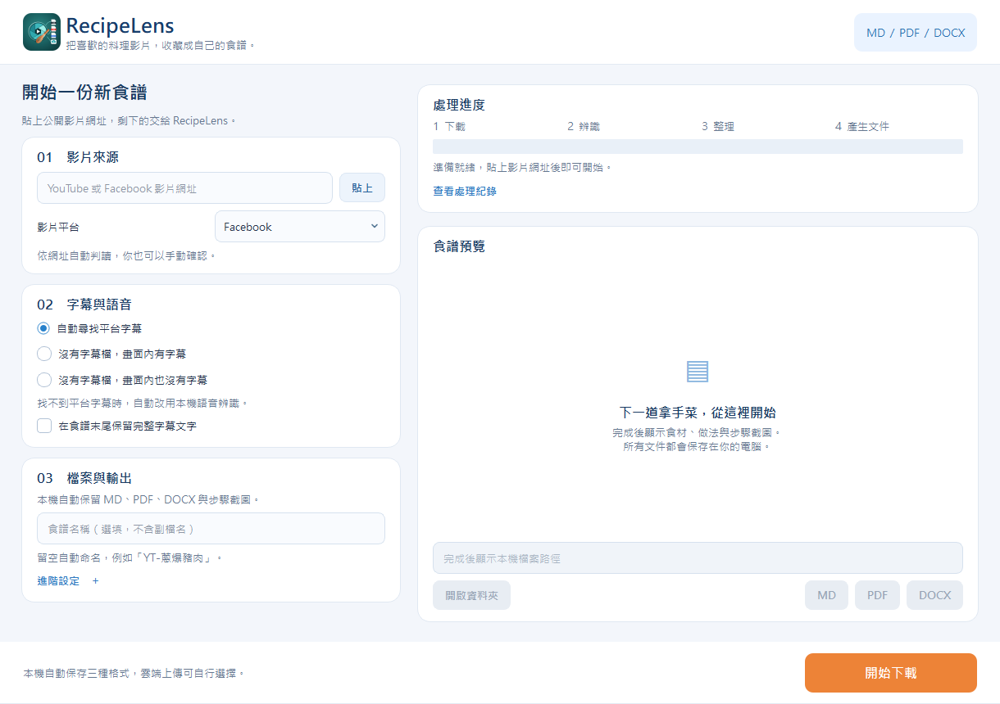
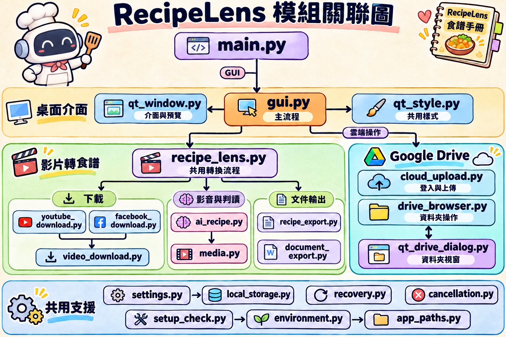

# 食影筆記（RecipeLens）

電腦版 App 名稱為「食影筆記」，專案、程式檔與安裝資料夾沿用英文名稱 RecipeLens。

從 YouTube 或 Facebook 料理影片整理繁體中文食譜，輸出 Markdown、PDF、DOCX 與關鍵步驟截圖，並可選擇上傳到 Google 雲端硬碟。



## 安裝與首次設定

### 安裝版

下載最新版安裝程式：<https://github.com/3mofstudy/RecipeLens/releases/latest/download/RecipeLens-Setup.exe>（尚未進行程式碼簽章）。

預設安裝到 `%LOCALAPPDATA%\Programs\RecipeLens`，不需要系統管理員權限，也可選擇為所有使用者安裝。安裝程式會建立開始功能表捷徑（桌面捷徑可選），可從 Windows「設定 → 應用程式」解除安裝。FFmpeg、yt-dlp 與 Deno 已內附。

| 內容 | 位置 |
|---|---|
| 程式、FFmpeg、yt-dlp、Deno | 安裝資料夾 `tools\` |
| 設定與 Google 授權 | `%LOCALAPPDATA%\RecipeLens\config\` |
| 食譜輸出（預設） | 「文件\RecipeLens\」，可在本機設定更改 |

升級或解除安裝不會刪除設定與食譜。

### AI 工具（擇一）

RecipeLens 使用 Codex 或 Claude Code 判讀影片，安裝下列任一種桌面版即可：

| AI | 下載 | 方案 | 安裝後要做的事 |
| --- | --- | --- | --- |
| ChatGPT 桌面版（Codex） | Microsoft Store <https://apps.microsoft.com/detail/9PLM9XGG6VKS> 或 `winget install --id 9PLM9XGG6VKS -s msstore` | 免費帳號可用部分模型；付費方案模型較多、額度較高 | 開啟並登入，切到「Codex」一次 |
| Claude 桌面版（Claude Code） | <https://claude.com/download> 或 `winget install Anthropic.Claude` | 需 Claude Pro 以上；免費帳號不含 Claude Code | 開啟並登入，點「Code」分頁一次等它下載 |

- 已安裝獨立的 Codex CLI 或 Claude Code CLI 也可使用，且優先採用；可用環境變數 `CODEX_CLI_PATH` 指定 `codex.exe`。
- 第一次開啟會先顯示「環境檢查」畫面，至少找到一種 AI 工具才能進入主畫面。之後可從「進階設定 → 檢查 AI 桌面版安裝」重新開啟。
- Claude 使用 Pro／Max 月租額度，不需要 API 金鑰；RecipeLens 會略過 `ANTHROPIC_API_KEY`，用量與 claude.ai 共用。

### 登入 AI 帳號

按「登入 Codex／Claude 帳號」會開啟瀏覽器並顯示「請在瀏覽器完成登入」視窗，登入完成後自動關閉。要放棄請按「取消登入」，關閉瀏覽器分頁不會通知 RecipeLens。想換帳號時，先在瀏覽器的 ChatGPT／Claude 網站登出再登入。第一次用 Claude 轉換或登入過期時，也會自動開啟瀏覽器請你登入。

### 從原始碼執行

1. 安裝 uv 與 FFmpeg，將包含 `ffmpeg.exe`、`ffprobe.exe` 的資料夾加入 PATH；也可直接放在專案的 `tools/ffmpeg/bin/`（不納入版本控制）。YouTube 擷取需要 Deno 或 Node.js 22 以上。
2. 安裝相依套件並啟動 GUI：

   ```powershell
   uv sync --locked --extra transcription
   uv run --locked --extra transcription python main.py
   ```

3. 使用 Codex 時可先執行 `codex login`，或在 GUI 內登入。

原始碼執行時，設定與輸出使用專案內的 `config/`、`output/`。請在專案根目錄執行，`src` 內的模組使用套件相對匯入，統一從 `main.py` 啟動。

## GUI 使用方式

左側為影片設定，右側為進度與食譜預覽；左右區塊可拖曳調整寬度，底部「開始下載」始終可操作。

1. 貼上公開影片網址，程式自動預選 Facebook 或 YouTube，也可手動確認。網址欄會記住上一次的內容。
2. 選擇字幕資訊：預設「自動尋找平台字幕」；另可指定「畫面內有字幕」或「畫面內也沒有字幕」，後者可選國語、粵語、閩南語、其他的語音。找不到平台字幕時自動改用本機語音辨識。
3. 「自動尋找平台字幕」模式可勾選「在食譜末尾保留完整字幕文字」，附加文字會移除時間軸、序號、格式標籤及重複句。
4. 食譜名稱可留空，由 AI 判讀後以「平台-頻道名稱-食譜名稱」命名，例如 `Youtuber-豫魯小學堂-高麗菜水煎包`、`Facebook-頻道名稱-蔥爆豬肉`。頻道名稱缺少時標示「未知頻道」，重名時加上 `-2`、`-3`。
5. 按「開始下載」，右側顯示實際階段與可展開的處理紀錄，處理中鎖定設定避免重複工作。右上「中止執行」可隨時停止；若 5 秒後仍未停止，按鈕會變成「強制結束」。手動中止不會自動修復或回報錯誤，已產生的本機檔案會保留，已送出的雲端操作不會撤回。
6. 完成後自動保存 MD、`images/` 截圖，以及已勾選的 PDF 或 DOCX。右側顯示食譜預覽與路徑，可直接開啟資料夾或文件。

設定分區：

- 「02　AI 模型選定」：Codex／Claude、模型選單、帳號登入與桌面版安裝檢查。模型清單依帳號方案顯示，預設為最省額度的模型。
- 「03　本機設定」：輸出位置、食譜命名與檔案類型。MD 和截圖固定輸出，PDF 與 DOCX 預設勾選。
- 「進階設定」（預設收合）：「04　字幕與語音」和「05　Google 雲端上傳」。

### 上傳到 Google 雲端硬碟

所有設定在按「開始下載」前完成，轉換與上傳一次跑完，中途不再詢問：

1. 在「進階設定」勾選「轉換完成後上傳到 Google Drive」，勾選上傳格式（MD、PDF、DOCX 可複選，選 MD 時也會上傳截圖），並按「選擇」指定雲端存放位置。位置會保存為預設值。所有食譜都存放在「我的雲端硬碟」下由 App 自動建立的「食影筆記」資料夾內。
2. 按「開始下載」。勾選上傳卻還沒選資料夾或格式時，會先提示，不開始轉換。
3. 轉換完成後，在存放位置下建立以食譜命名的資料夾，例如「食影筆記 > 09.我的食譜 > Youtuber-頻道名稱-蔥爆豬肉」，結構與本機相同。
4. 上傳完成後顯示存放位置與檔案，可在瀏覽器開啟該資料夾。

雲端資料夾視窗類似檔案總管：以「食影筆記」資料夾為最上層，可進入子資料夾、返回上一層（Backspace）、新增資料夾與重新整理。第一次上傳時會開啟 Google 授權畫面，App 只要求存取「自己建立的檔案與資料夾」（`drive.file`），看不到雲端硬碟裡的其他檔案。在雲端把「食影筆記」資料夾改名或搬到別處都不影響上傳；移到垃圾桶時，下次上傳會重新建立。上傳取消或失敗時，本機檔案仍完整保留。

從舊版升級：舊版使用完整雲端硬碟權限，升級後第一次上傳要重新登入 Google，並重新選擇雲端存放位置（舊位置不是 App 建立的，無法沿用）。先前上傳的檔案留在原處不受影響。

## 命令列

```powershell
uv run --locked --extra transcription python main.py "https://www.facebook.com/reel/4545497162337751"
```

| 參數 | 說明 |
|---|---|
| `--provider Claude` | 改用 Claude Code 判讀，預設為 Codex |
| `--model <模型名稱>` | 指定模型；遇到 `model_not_found` 時改用帳號可用的模型 |
| `--subtitle-mode auto\|embedded\|none\|original` | 對應 GUI 的字幕模式，預設 `auto` |
| `--subtitle-file "字幕.srt"` | 搭配 `original` 模式使用自備字幕 |
| `--keep-subtitles` | 在食譜末尾保留完整字幕文字 |
| `--speech-language 粵語` | 無字幕時的語音語言，未指定時自動偵測 |
| `--output <資料夾>` | 輸出根目錄 |
| `--name "三杯雞"` | 本機 MD、PDF、DOCX 的共同檔名 |

每次成功執行會建立 `output/<平台-頻道名稱-食譜名稱>/`，內含同名的 `.md`、`.pdf`、`.docx` 和 `images/`。搬移 Markdown 時請保留圖片資料夾；PDF／DOCX 已嵌入圖片。

單獨上傳既有食譜：

```powershell
uv run --locked --extra transcription python -m src.cloud_upload "output/食譜資料夾/食譜.md" --format both
```

`--format` 接受 `md`、`pdf`、`docx`、`both`（PDF 和 DOCX）或 `all`；也可用 `--formats md docx` 自訂組合。`--folder-id` 指定雲端父資料夾（須為 App 建立的資料夾，省略時使用「食影筆記」資料夾）、`--new-folder` 建立新資料夾、`--name` 指定雲端檔名，首次可用 `--client-secrets` 傳入 Google 用戶端 JSON。對同一份 Markdown 重試會沿用已上傳的檔案，不會建立重複檔案。

## 處理流程

1. yt-dlp 取得影片、字幕與資訊欄。
2. **YouTube 資訊欄優先**：資訊欄依序出現食材與做法標題、食材至少兩筆數字份量、做法至少兩個料理動作時，直接保留資訊欄原文，不呼叫 AI 也不做語音辨識。此規則無法證明語意完整，可能誤判；保留原文時不翻譯，附上的圖片為影片參考畫面，未與步驟逐一配對。
3. 沒有可用字幕時，以 faster-whisper 在本機辨識語音。國語使用 small 模型；粵語與閩南語使用較大的 large-v3-turbo，首次使用需下載並占用較多記憶體，閩南語結果需核對。
4. FFmpeg 擷取候選畫面（內嵌字幕模式最多 60 張，其餘最多 12 張），連同字幕或逐字稿交給 Codex／Claude 判讀，回傳結構化的食材與步驟。畫面內的字幕會與語音及影片說明互相核對，但仍可能漏掉短暫出現的字幕。
5. 依步驟時間擷取截圖，產生 Markdown，再轉成 PDF、DOCX。影片未提供的用量、時間或溫度標示「影片未說明」。

所選模型不可用時，會有限次改用其他可用模型，不修改全域 Codex 設定。請使用你有權處理的影片；平台可能限制擷取公開影片，失敗時會顯示原因。

## 錯誤處理與自動修復

GUI 處理過程發生錯誤時，會詢問是否自動修復：

- 選「否」：中止本次工作，再詢問是否回報錯誤摘要給開發者；拒絕則不送出。
- 選「是」：先辨識已知錯誤，未知錯誤交由目前所選的 AI 判讀（可能消耗額度）。只會重新登入或重試失敗步驟，每階段最多一次；不執行 AI 產生的命令，也不修改程式或全域設定。
- 修復後仍失敗：中止並直接回報錯誤摘要。
- 額度或流量限制不會再呼叫 AI 重試，會提示等待額度重設或檢查帳戶方案。

中止時，影片、字幕等中間檔保留在輸出位置的 `.recipe-lens-*` 資料夾，MD、圖片與已完成的文件也會保留；成功時才清理。保留的工作資料不會自動續跑，可自行確認後刪除。

錯誤回報只送出一次，內容為回報編號、版本、作業系統、AI 平台、失敗階段、錯誤摘要與診斷建議；會遮蔽憑證、網址與本機路徑，不附加影片、食譜、字幕或設定檔。送出失敗時顯示「未送出」，不自動重送。

## 專案目錄

```text
RecipeLens/
├── main.py                      # 正式入口，無參數啟動 GUI，有網址參數啟動 CLI
├── tests/                       # 測試專用資料夾
│   ├── __init__.py              # 宣告 RecipeLens 測試套件
│   ├── qt_support.py            # 提供離屏模式的共用 QApplication
│   ├── test_app_paths.py        # 驗證安裝版的工具、設定與食譜輸出路徑
│   ├── test_cancellation.py     # 使用本機子程序驗證背景工作取消
│   ├── test_cloud_upload.py     # 驗證轉檔、格式選擇與上傳失敗後重試
│   ├── test_drive_browser.py    # 模擬 Drive API 驗證資料夾瀏覽、新增與選取
│   ├── test_environment.py      # 驗證工具偵測與主要轉換流程
│   ├── test_gui.py              # 驗證 GUI 的本機路徑顯示與上傳流程
│   ├── test_naming_and_ai.py    # 驗證食譜命名、AI 回應與模型處理、字幕整理及 Markdown 圖片上傳
│   ├── test_recovery.py         # 驗證錯誤修復、本機資料保留與錯誤報告
│   ├── test_setup_check.py      # 驗證 Codex 與 Claude Code 的環境檢查及桌面版偵測
│   └── test_video_download.py   # 驗證中文路徑下的下載結果解析與背景子程序終止
├── src/                         # 應用程式模組
│   ├── __init__.py              # 宣告 RecipeLens 應用程式套件
│   ├── ai_recipe.py             # 呼叫 Codex 或 Claude Code 判讀食譜，處理模型、登入及結果驗證
│   ├── app_paths.py             # 定義原始碼與安裝版的工具、資源、設定及輸出路徑
│   ├── cancellation.py          # 提供背景工作的取消範圍與中止檢查
│   ├── cloud_upload.py          # 處理 Google Drive 登入、授權快取與文件上傳
│   ├── document_export.py       # 將食譜 Markdown 與截圖轉成 PDF、DOCX
│   ├── drive_browser.py         # 提供 Drive 資料夾查詢與建立操作，並開啟選擇視窗
│   ├── environment.py           # 尋找 FFmpeg、ffprobe、yt-dlp、JavaScript 執行環境與 AI CLI
│   ├── facebook_download.py     # 下載單支公開 Facebook 影片及可用字幕
│   ├── gui.py                   # 啟動 PySide6 主視窗，協調背景轉換、進度回報與上傳
│   ├── local_storage.py         # 讀取並以原子方式寫入本機 JSON 紀錄
│   ├── media.py                 # 執行影音工具、整理字幕、辨識語音與擷取畫面
│   ├── qt_drive_dialog.py       # 建立 Qt 雲端資料夾選擇視窗，在背景呼叫 Drive API
│   ├── qt_style.py              # 定義共用配色與 Qt 元件樣式
│   ├── qt_window.py             # 建立卡片式介面、對話框與食譜預覽
│   ├── recipe_export.py         # 輸出食譜 Markdown 與步驟截圖
│   ├── recipe_lens.py           # 串接影片轉食譜的共用流程並提供命令列介面
│   ├── recovery.py              # 診斷錯誤、限制重試次數並提供去識別錯誤回報
│   ├── settings.py              # 定義、讀取及儲存進階設定
│   ├── setup_check.py           # 檢查 AI 工具是否已安裝並提供安裝說明
│   ├── video_download.py        # 驗證影片網址，透過 yt-dlp 取得影片、字幕與中繼資料
│   └── youtube_download.py      # 下載 YouTube 影片並檢查資訊欄是否已有完整食譜
├── assets/                      # App 圖示（icons/）與介面符號（ui/）
├── docs/                        # 開發文件、說明圖片與錯誤回報接收端程式
├── packaging/                   # PyInstaller 與 Inno Setup 打包設定
├── pyproject.toml
├── uv.lock
├── readme.md
└── output/                      # 原始碼執行時的預設食譜輸出
```

### 模組關聯圖



Q 版圖呈現 GUI、影片轉食譜與 Google Drive 的主要呼叫關係。CLI 傳入網址時，會從 `main.py` 直接進入 `recipe_lens.py`。

[查看模組匯入關係圖（SVG）](docs/images/module-graph.svg)。SVG 的箭頭由匯入方指向被匯入的模組，顏色代表匯入方所在的層級。虛線表示在函式內延遲匯入，以避開循環匯入。新增或移除模組間的匯入時請同步更新 SVG。

## 開發與測試

開發規則見根目錄 `AGENTS.md`。食譜產物驗證與轉換故障排查可使用 `.agents/skills/recipelens-validate/SKILL.md`，在 Codex 輸入 `$recipelens-validate`，例如：「使用 $recipelens-validate 檢查指定食譜的三種文件與截圖，不重新下載或上傳。」

執行完整測試：

```powershell
uv run --locked --extra transcription python -m unittest discover -s tests -p "test_*.py" -v
```

測試使用模擬的下載、AI 與 Google API，不下載影片、不消耗 AI 額度，也不建立真實雲端檔案；PDF／DOCX 會實際產生以檢查中文與圖片。GUI 與雲端資料夾測試共用 `tests/qt_support.py` 的 QApplication，以 offscreen 模式執行。真實影片、AI 與雲端上傳屬整合驗證，需另行執行。

打包與發版、Google OAuth 用戶端設定及錯誤回報接收端的架設，見 [docs/development.md](docs/development.md)。
